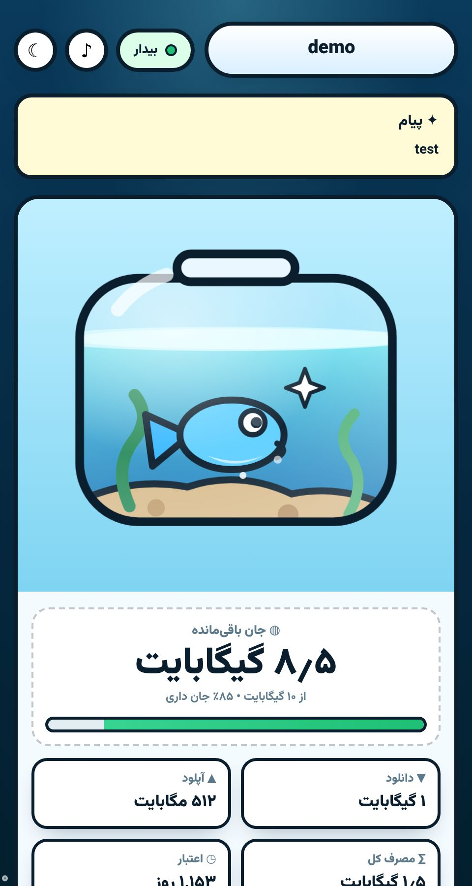
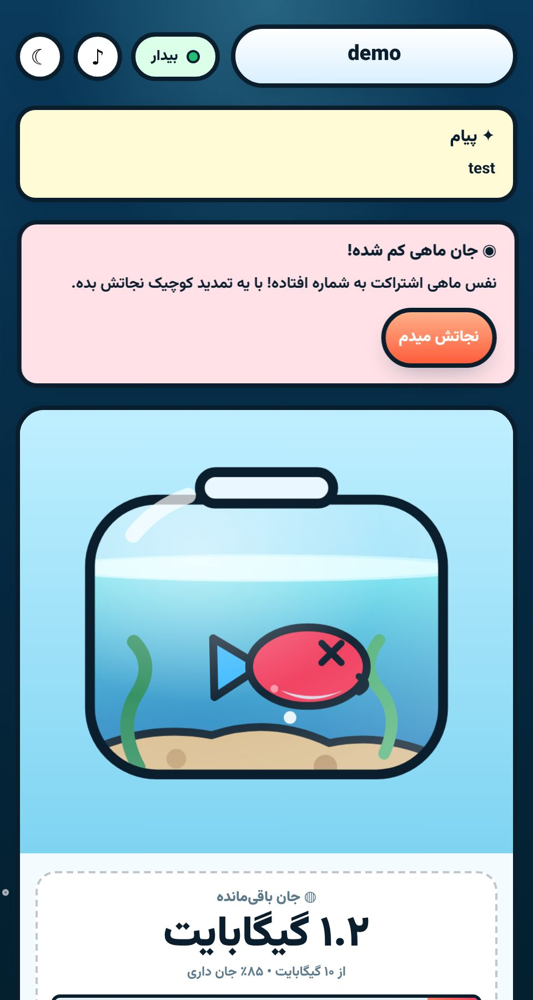

# serene subscription page

A small Persian subscription page with a live aquarium. The fish reacts to
remaining traffic and expiry, so users see their quota at a glance.

## what it does

- shows remaining traffic, download/upload, total used and days left
- the tank water level follows the remaining quota
- the fish mood changes: happy, weak, sleep, panic, cry
- copy link and QR buttons, JSON and Clash export links
- live update every 10 seconds, offline-friendly
- announcement box and disabled-subscription notice

## files

- `sub.html` - page template (x-ui template tags)
- `style.css` - all the styling
- `app.js` - usage rendering, fish state, rows, QR, polling

## quick start

Drop the three files next to each other and serve them. The page reads
its data from `data-*` attributes on `<body>`, filled by the panel:

```html
<body data-dl="{{ .downloadByte }}" data-ul="{{ .uploadByte }}"
  data-cap="{{ .totalByte }}" data-exp="{{ .expire }}"
  data-sub="{{ .subUrl }}" data-ti="{{ .subTitle }}">
```

No build step. QR library loads lazily from cdnjs only when opened.

## screenshots




## license

MIT
